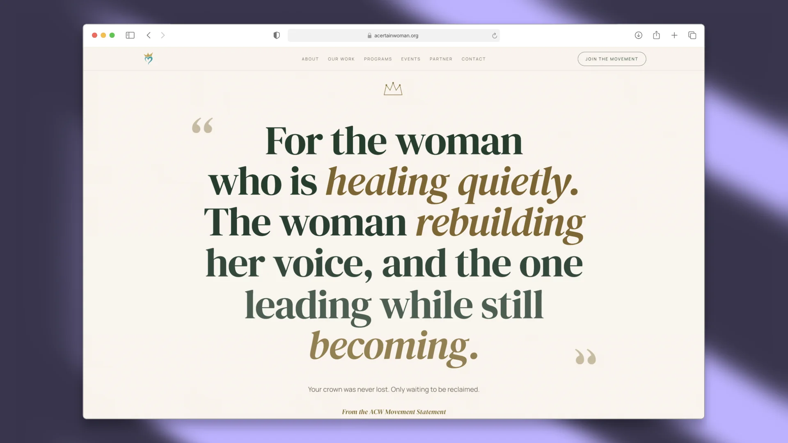
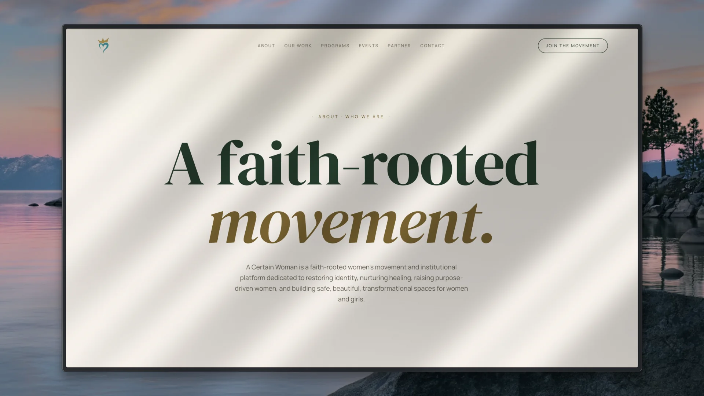
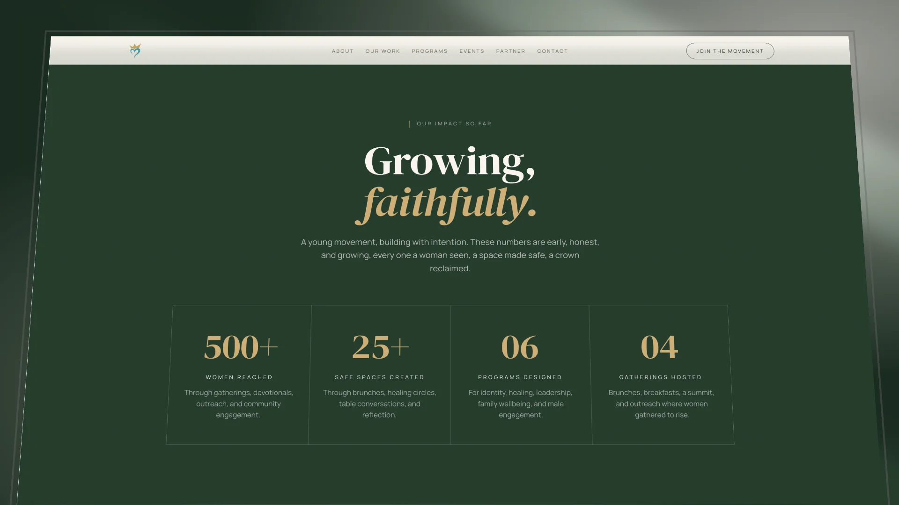
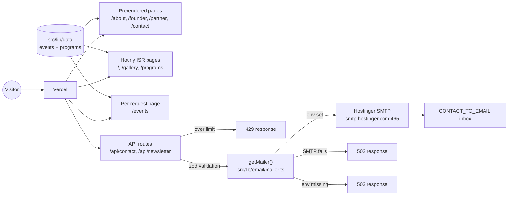
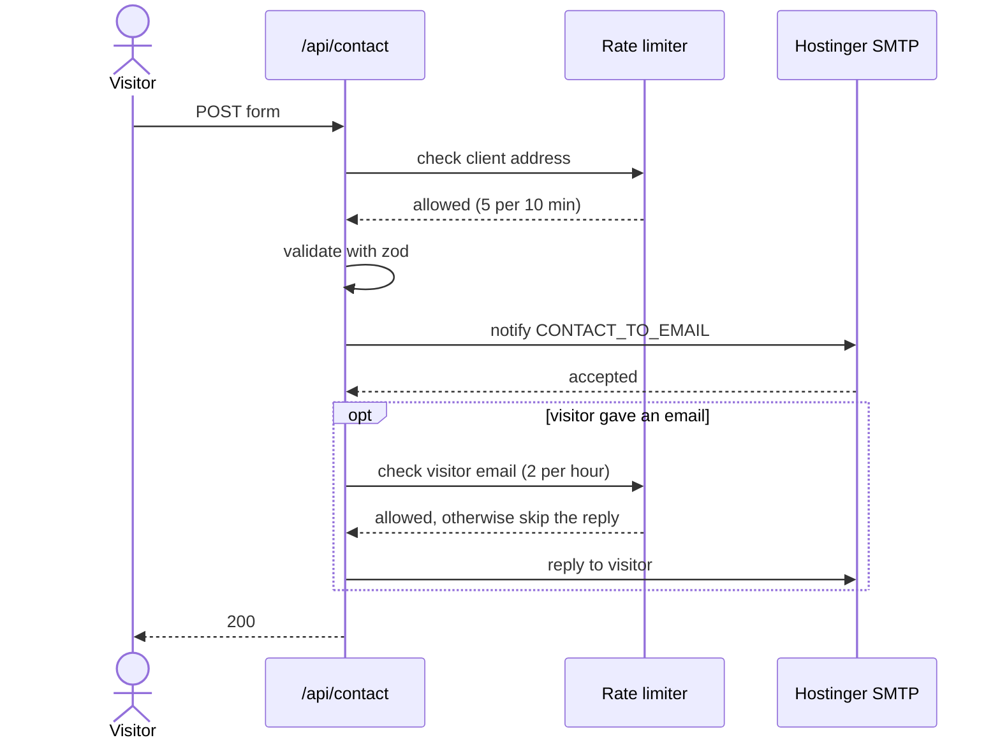

# A Certain Woman

[](https://github.com/lawalOyinlola/a_certain_woman/actions/workflows/ci.yml)
[](https://github.com/lawalOyinlola/a_certain_woman/actions/workflows/security.yml)



A Certain Woman is a faith-rooted women's movement in Freetown, Sierra Leone, and this repository is its public website at [acertainwoman.org](https://www.acertainwoman.org). The site tells the movement's story, lists its programs and gatherings, keeps a gallery of every event, and gives visitors two ways to reach out: a contact form and a newsletter signup. Its tagline sets the tone for everything else in here: _Restoring Hearts. Reclaiming Crowns._

The design is meant to feel like a slow magazine rather than a product page, with cream paper, forest green and gold, and serif headlines that take their time. That intent shapes a lot of the code, so if you're about to change how something looks, read [`DESIGN.md`](./DESIGN.md) first.

<table>
  <tr>
    <td width="33%"></td>
    <td width="33%"></td>
    <td width="33%"></td>
  </tr>
  <tr>
    <td align="center"><sub>About</sub></td>
    <td align="center"><sub>Founder's letter</sub></td>
    <td align="center"><sub>Impact, on the home page</sub></td>
  </tr>
</table>

## Stack


- [Next.js 16](https://nextjs.org) with the App Router and Turbopack, on React 19 and TypeScript
- [Tailwind CSS v4](https://tailwindcss.com), with the brand tokens exposed through `@theme inline`
- [shadcn/ui](https://ui.shadcn.com) (base-nova style) on Radix and `@base-ui/react`. Its stylesheet is vendored in `src/app/shadcn.css`, and the CLI runs on demand (see [docs/dependencies.md](./docs/dependencies.md) for why)
- [GSAP](https://gsap.com) and ScrollTrigger for the scroll reveals
- [Nodemailer](https://nodemailer.com) over SMTP for the form emails, sent through the Hostinger mailbox
- [Zod](https://zod.dev) for validating what the forms send
- DM Serif Display, Manrope and Caveat through `next/font/google`

## Getting started

You'll need Node.js 24 or later and [pnpm](https://pnpm.io). The pnpm version is pinned in `packageManager` in `package.json`, so running `corepack enable` once is enough to get the right one. Node.js 25 dropped corepack from the install, so on 25 or later run `npm install -g corepack` first.

```bash
pnpm install
pnpm dev
```

Then open <http://localhost:3000>. The other scripts you'll use:

```bash
pnpm build      # Production build
pnpm start      # Run the production build
pnpm lint       # ESLint
pnpm typecheck  # tsc --noEmit
```

## Environment

The site runs without any environment variables at all. Only the two forms need credentials, and without them they answer `503` while every page keeps working, which is also why CI can build without secrets. Copy `.env.example` to `.env.local` to start, or use the keys below.

```bash
# Canonical origin. Absolute metadata, canonical links, OG images,
# robots.txt, sitemap.xml, llms.txt and the email logo resolve against this.
NEXT_PUBLIC_SITE_URL=https://www.acertainwoman.org

# Email delivery for /api/contact and /api/newsletter, over SMTP.
# SMTP_USER and SMTP_PASS sign in to the Hostinger mailbox.
SMTP_USER=info@acertainwoman.org
SMTP_PASS=the-mailbox-password
CONTACT_TO_EMAIL=where-alerts-land@example.com

# Optional. The sender shown to the reader. The address must be the mailbox
# or one of its aliases. Defaults: SMTP_USER and "A Certain Woman".
# SMTP_FROM=hello@acertainwoman.org
# SMTP_FROM_NAME=A Certain Woman

# Optional. These are the defaults, which are Hostinger's.
# Port 465 uses implicit TLS. Port 587 uses STARTTLS.
# SMTP_HOST=smtp.hostinger.com
# SMTP_PORT=465
```

Production needs the same variables in the Vercel project settings. It's worth giving the site a mailbox password of its own, because then you can rotate it without locking yourself out of webmail. When `NEXT_PUBLIC_SITE_URL` is unset, the code falls back to `https://www.acertainwoman.org`.

## How it fits together

Almost all of the site is prerendered. Every page is a Server Component built ahead of time, `/`, `/gallery` and `/programs` refresh at most once an hour, and only `/events` renders on each request. The one piece of real server work at runtime is the pair of form routes, which validate what they're given and send email over SMTP.



Most pages stay Server Components so they can export `metadata`. Where a page needs interactivity, that part moves into a `"use client"` child next to it (`/contact` has `contact-form.tsx`, `/events` has `events-browser.tsx`), and `page.tsx` keeps ownership of the SEO.

## Email

A form submission always reaches the team first. Once that email is accepted, and only if the visitor gave an email address, they get a reply of their own: the contact form confirms that their message arrived and that someone will answer, and the newsletter form welcomes them to the list and says what the letters will be like. Both replies point to the events page, and every email, including the team's, ends with the tagline and a link to the site.



The order matters because the reply is the less important of the two. If the team email fails, the visitor sees an error (`502`) and can try again. If the reply fails, it's logged and the visitor still sees success, since the message they cared about has already landed. A `503` means the SMTP variables aren't set, and in both failure cases the function log shows the SMTP server's answer, never the password.

The templates live in `src/lib/email/`, and every value a visitor typed passes through `escapeHtml` before it goes into the HTML. The logo in the header is `public/assets/email-logo.png`, a 14 KB PNG rather than the SVG, because most email clients block SVG. It's linked by absolute URL from `NEXT_PUBLIC_SITE_URL`, so it only appears once the file is deployed. In a local test the image points at production and shows as broken until then.

Rate limits keep the forms from being turned against anyone. The contact and newsletter routes each allow 5 requests per 10 minutes from one client address, and past that they answer `429` with a `Retry-After` header. Each visitor email address also gets at most 2 replies per hour, counted across both forms together, so nobody can use the forms to fill a stranger's inbox. Hitting that second limit only skips the reply: the team still gets the submission, and a failed team email doesn't use up the allowance.

Those limits live in memory (`src/lib/rate-limit.ts`), and that's a real limitation. Each serverless instance counts on its own and a cold start resets the count, so the limiter stops one person or script hammering the form but won't stop a distributed attack. A hard limit needs a shared store such as Redis or Vercel KV behind the same function, and a bot check like Cloudflare Turnstile is worth adding before a big launch.

## Content and media

There's no CMS. Events and programs are plain TypeScript data in `src/lib/data/`, so adding a gathering means adding an entry to `EVENTS` and putting its photographs in `public/media/<event>/`.

Photos appear in a shuffled order, and the shuffle is seeded in both places it happens, so the server and the browser agree and nothing jumps after the page loads. Each event gallery uses a seed taken from the event id, which keeps it stable across builds: someone coming back finds the gallery the way they left it. The `/gallery` page mixes every event together with a seed taken from the time on the server, and because the page sits behind `revalidate = 3600`, the mix changes at most once an hour.

Photographs are resampled to 2560px on the long edge at quality 85 before they're committed. The camera originals are 6000×4000 and about 25 times larger than anything the site serves. Films are re-encoded when the source is far above what the player needs.

## Design system

[`DESIGN.md`](./DESIGN.md) has the full visual language. In short:

- **Palette:** cream `#faf6ee`, ink `#1f2620`, forest `#1f3d2b`, gold `#b6914a` and gold-2 `#d4ae6b`
- **Type:** DM Serif Display for display and italics, Manrope for body text, Caveat for accents
- **Layout primitives:** `acw-twoup`, `acw-checklist`, `acw-value-card`, `acw-section-label`, `acw-page-hero`, `acw-footer-grand`
- **Surfaces:** stacked cream gradients, `acw-bg-forest` for the dark block, and a gold radial glow behind the anthem disc

The tokens sit in `:root` and are re-exported through `@theme inline` in `src/app/globals.css`, which is what makes utilities like `text-forest`, `bg-cream-1` and `border-gold-2/15` work.

## SEO

Every route sets its own `title`, `description` and canonical URL, on top of the root metadata in `src/app/layout.tsx` (title template, Open Graph, Twitter card, robots, `theme-color` and icons). Structured data lives in `src/config/jsonld.ts`, including one entry per event on `/events`, and `robots.txt` and `sitemap.xml` are generated at build from `app/robots.ts` and `app/sitemap.ts`. There's also `/llms.txt`, a plain-text summary for language models built from the same event data the pages use.

Wrong URLs are handled deliberately. The 404 page is marked `noindex` and suggests the nearest real page instead of redirecting, so a typo never answers `200`. The aliases people actually reach for (`/contacts`, `/donate`, `/programme` and so on) are written out as redirects in `next.config.ts`, so every redirect on the site can be reviewed in one place.

All of this resolves against `NEXT_PUBLIC_SITE_URL`, so set it to the production origin.

## CI and dependencies

Nothing reaches `main` without five checks passing: `Lint, typecheck and build`, `Dependency audit`, `Dependency review`, `Secret scan` and `CodeQL`. Branch protection on `main` requires all five, along with CodeQL's code scanning results.


- [docs/ci.md](./docs/ci.md) covers what each workflow does, how branch protection is set up, and what to do when a check fails.
- [docs/dependencies.md](./docs/dependencies.md) covers the 14-day rule for new releases, how to fix an advisory, and how to clean up overrides afterwards.

## Deploy

The site runs on [Vercel](https://vercel.com), which deploys `main` after every merge. That makes the CI checks the last gate before production, so the environment variables above need to be in the project settings before a deploy that depends on them.

Any platform that can run `next build` and `next start` will work too. The repository carries its own photography in `public/media`, so a shallow clone builds fastest. Outside Vercel, put the app behind an ingress that overwrites `x-real-ip` and `x-forwarded-for`, because otherwise a caller can choose their own rate-limit key.

## Conventions

- Prefer Tailwind utility classes. Reach for `@layer components` in `globals.css` only for primitives used across pages (the `acw-*` classes).
- `@apply` only references built-in utilities and theme tokens, because Tailwind v4 can't `@apply` custom component classes.
- Keep `page.tsx` files as Server Components so they can export `metadata`, and push interactivity into a `"use client"` child beside them.
- Anything that differs between server and client, such as a URL hash or a random order, has to be seeded or deferred to an effect, or it becomes a hydration mismatch. That's what `src/lib/shuffle.ts` is for.
- Animation respects `prefers-reduced-motion`, and the reveal helpers already handle it.
- The site is English only and driven by content.

## Project layout

```text
src/
  app/                      # Routes (App Router)
    layout.tsx              # Root layout: fonts, root metadata, viewport
    page.tsx                # Home
    not-found.tsx           # 404, with a nearest-page suggestion
    loading.tsx             # Route-level loading fallback
    globals.css             # Tailwind v4 layers + ACW design tokens
    shadcn.css              # vendored from the shadcn package
    robots.ts               # robots.txt
    sitemap.ts              # sitemap.xml
    llms.txt/               # llms.txt, a plain-text site summary for models

    about/                  # /about
    founder/                # /founder, the founder's letter
    programs/               # /programs
    events/                 # /events: server page + client browser
    gallery/                # /gallery
    partner/                # /partner
    contact/                # /contact: server page + client form
    api/
      contact/              # POST: contact form, team email + reply
      newsletter/           # POST: newsletter signup, team email + welcome

  components/
    site/                   # Nav, Footer, PageHero, Reveal, icons,
                            # announcement banner, 404 suggestion
    sections/               # Hero, WhoWeServe, Manifesto, Impact, Founder,
                            # Anthem, Join, Events, EventDetail, Gallery,
                            # Programs, WomenPrograms, MenWhoStand, OurWork, Faq
    ui/                     # shadcn primitives + phone field, lightbox

  config/                   # site constants, metadata, JSON-LD
  hooks/                    # useGsapReveal
  lib/
    data/                   # events + programs content
    email/                  # SMTP transport (mailer.ts), templates, escape + layout helpers
    hooks/                  # useDebouncedValue
    rate-limit.ts           # in-memory sliding-window limiter for the form routes
    routes.ts               # public route list + nearest-match for the 404
    shuffle.ts              # seeded, hydration-safe shuffling
    utils.ts                # shadcn `cn()`

docs/
  ci.md                     # workflows, branch protection, failing checks
  dependencies.md           # update policy, advisories, overrides
  assets/                   # diagrams and README screenshots

.github/
  workflows/ci.yml          # lint, typecheck, build, audit, dependency review
  workflows/security.yml    # gitleaks secret scan + CodeQL
  dependabot.yml            # weekly npm + Actions updates, 14-day cooldown

public/
  assets/                   # logos, icons, OG image, email logo, anthem audio, portraits
  media/                    # event photography and films, one folder per event
```

## Not shipped yet

`/stories` is on hold until there are real stories to tell. Rather than leave it half-built, the route and its components were removed, and `/stories`, `/story` and `/testimonials` redirect to `/gallery` with a temporary (307) redirect, so the URL can be reclaimed when the page comes back. The old implementation is still in git history.
