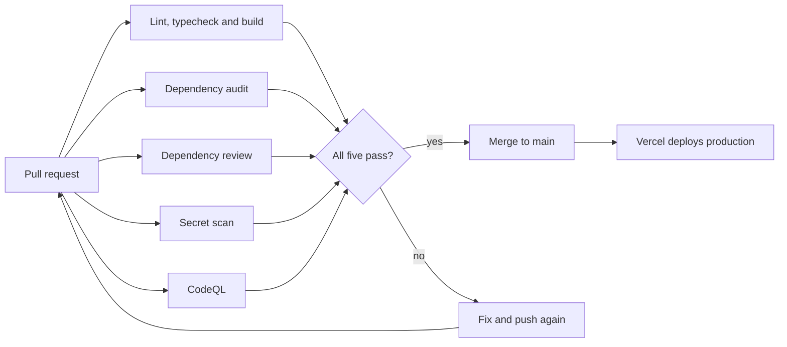

# CI and security checks

Every change passes through two GitHub Actions workflows before it reaches `main`. That matters more than it might look, because Vercel deploys `main` on every merge, so these checks are the last thing standing between a pull request and the live site.


## Workflows

| Workflow | Job | Runs on | Fails when |
| --- | --- | --- | --- |
| [`ci.yml`](../.github/workflows/ci.yml) | Lint, typecheck and build | pull request, push to `main` | `tsc`, ESLint or `next build` reports an error |
| | Dependency audit | pull request, push to `main`, daily 06:00 UTC | `pnpm audit` finds a high or critical advisory |
| | Dependency review | pull request | the PR adds a package with a moderate or worse advisory |
| [`security.yml`](../.github/workflows/security.yml) | Secret scan | pull request, push to `main`, Mondays 05:00 UTC | the gitleaks CLI finds a secret in any commit in git history |
| | CodeQL | pull request, push to `main`, Mondays 05:00 UTC | CodeQL `security-extended` queries find an issue |

The scheduled runs are there because the world changes even when the code doesn't. A new advisory can land against a package that was fine yesterday, and CodeQL adds queries over time, so the audit runs daily and the security scans weekly. When a scheduled run fails, GitHub emails the repository owner.

## What happens on a pull request



## Why it's built this way

Every third-party action is pinned to a full commit SHA instead of a tag, because whoever controls an action can move its tag to new code, and nobody can move a SHA. The comment after each SHA says which version it is, and Dependabot proposes new SHAs every week, so pinning doesn't mean falling behind.

The secret scan is the one place that breaks from that pattern. It runs the gitleaks CLI directly rather than gitleaks-action, because on a pull request the action scans with `--no-merges --first-parent` and skips any commit that arrived through a merged branch. The CLI scans every commit in history. Its download is pinned to a version and a SHA-256, and since Dependabot can't update that, an upgrade means changing `GITLEAKS_VERSION` and `GITLEAKS_SHA256` in `security.yml` by hand, with the hash copied from the release's `checksums.txt`.

The workflows hold as little power as they can. The token is read-only, and only the CodeQL job gets `security-events: write` so it can upload results to the Security tab. The build doesn't use any secrets either: the SMTP transport is created on the first request rather than when the module loads (see [`src/lib/email/mailer.ts`](../src/lib/email/mailer.ts)), so a pull request from a fork can't read production credentials and a missing variable can't break CI.

Installs come straight from the lockfile. `pnpm install --frozen-lockfile` fails if `package.json` and `pnpm-lock.yaml` disagree, and install scripts only run for the packages listed in `allowBuilds` in [`pnpm-workspace.yaml`](../pnpm-workspace.yaml). Finally, a new push to a branch cancels the run already going for it, while a scheduled run and a push to `main` are kept apart so neither cancels the other.

## Branch protection

The checks only block a merge if `main` requires them, and that's a one-time setup in GitHub. Do it after the workflows have run at least once, because GitHub offers checks by job name and can't list one it has never seen. This repository already has it in place; the steps are here for reference and for checking it.

1. Open **Settings → Branches → Add branch ruleset** (or edit the rule for `main`).
2. Turn on **Require a pull request before merging**.
3. Turn on **Require status checks to pass** and add these five checks:
   - `Lint, typecheck and build`
   - `Dependency audit`
   - `Dependency review`
   - `Secret scan`
   - `CodeQL`
4. Turn on **Require code scanning results**. Select the `CodeQL` tool, set **Security alerts** to `High or higher` and **Alerts** to `Errors`. The `CodeQL` job passes when its analysis uploads, even if the analysis finds an issue. This rule blocks the merge when a pull request adds an alert at or above those levels.
5. Turn on **Block force pushes** and **Restrict deletions**.
6. Do not add a bypass for administrators.

Read the result back to confirm it:

```bash
gh api repos/lawalOyinlola/a_certain_woman/branches/main/protection \
  --jq '{checks: .required_status_checks.contexts, admins: .enforce_admins.enabled, force: .allow_force_pushes.enabled}'
```

A `404` means that `main` has no protection.

## When a check fails

| Check | First step |
| --- | --- |
| Lint, typecheck and build | Run `pnpm typecheck`, `pnpm lint` and `pnpm build` locally. They run the same commands. |
| Dependency audit | Follow [Fix an advisory](./dependencies.md#fix-an-advisory). |
| Dependency review | Read the job summary. It names the package and the advisory. Remove the package or pick a patched version. |
| Secret scan | Rotate the credential at the provider first. Then remove it from history. If the match is not a secret, add its fingerprint to [`.gitleaksignore`](../.gitleaksignore) with a comment. |
| CodeQL | Open the alert in the **Security** tab. It shows the data flow from source to sink. |

## Run the checks locally

```bash
pnpm install --frozen-lockfile
pnpm typecheck
pnpm lint
pnpm build
pnpm audit --audit-level high
gitleaks git .   # needs gitleaks, for example: brew install gitleaks
```
