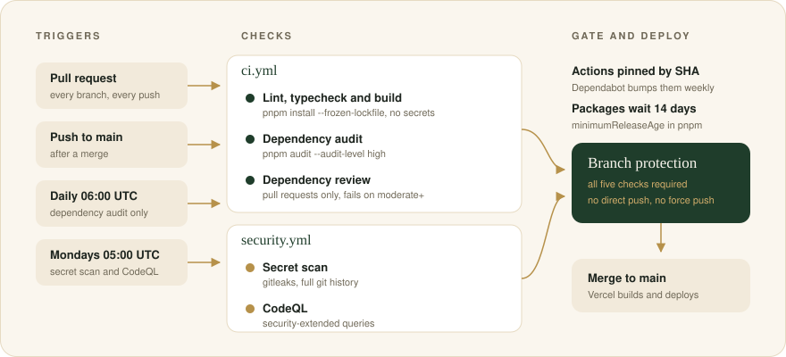
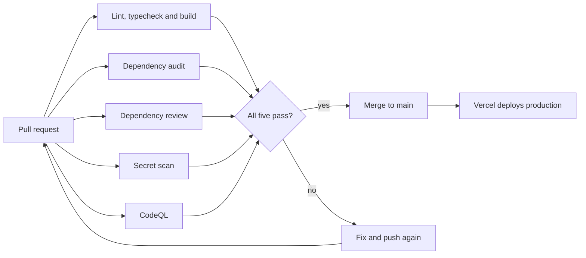

# CI and security checks

Two GitHub Actions workflows check every change before it reaches `main`. Vercel deploys `main`, so these checks are the last gate before production.



## Workflows

| Workflow | Job | Runs on | Fails when |
| --- | --- | --- | --- |
| [`ci.yml`](../.github/workflows/ci.yml) | Lint, typecheck and build | pull request, push to `main` | `tsc`, ESLint or `next build` reports an error |
| | Dependency audit | pull request, push to `main`, daily 06:00 UTC | `pnpm audit` finds a high or critical advisory |
| | Dependency review | pull request | the PR adds a package with a moderate or worse advisory |
| [`security.yml`](../.github/workflows/security.yml) | Secret scan | pull request, push to `main`, Mondays 05:00 UTC | the gitleaks CLI finds a secret in any commit in git history |
| | CodeQL | pull request, push to `main`, Mondays 05:00 UTC | CodeQL `security-extended` queries find an issue |

The scheduled runs exist because an advisory or a new CodeQL query can arrive while the code stays the same. A scheduled failure sends an email to the repository owner.

## What happens on a pull request



## Design decisions

- **Actions are pinned by commit SHA.** A tag can move. A SHA cannot. The comment after each SHA shows the version. Dependabot updates the SHAs weekly.
- **gitleaks runs as a CLI, not as gitleaks-action.** On a pull request, the action scans with `--no-merges --first-parent`, so it skips commits that arrive through a merged branch. The CLI scans every commit. The download is pinned to a version and a SHA-256. Dependabot does not update it. To update, change `GITLEAKS_VERSION` and `GITLEAKS_SHA256` in `security.yml`, and copy the hash from the `checksums.txt` file of the release.
- **The token is read-only.** Only the CodeQL job gets `security-events: write`, so that it can upload results to the Security tab.
- **The build uses no secrets.** The Resend client starts on the first request, not when the module loads (see [`src/lib/email/resend.ts`](../src/lib/email/resend.ts)). A fork's PR therefore cannot read production credentials, and a missing env var cannot break CI.
- **Install uses the lockfile.** `pnpm install --frozen-lockfile` fails if `package.json` and `pnpm-lock.yaml` disagree. Install scripts run only for the packages in `allowBuilds` in [`pnpm-workspace.yaml`](../pnpm-workspace.yaml).
- **Concurrency cancels stale runs.** A new push to the same branch cancels the older run for that branch. A scheduled run and a push to `main` do not cancel each other.

## Branch protection

The checks block a merge only when `main` requires them. Set this up once, after the workflows have reported at least once. GitHub lists a check by its job name, so a check that never ran cannot be selected.

1. Open **Settings → Branches → Add branch ruleset** (or edit the rule for `main`).
2. Turn on **Require a pull request before merging**.
3. Turn on **Require status checks to pass** and add these five checks:
   - `Lint, typecheck and build`
   - `Dependency audit`
   - `Dependency review`
   - `Secret scan`
   - `CodeQL`
4. Turn on **Require code scanning results**. Select the `CodeQL` tool, set **Security alerts** to `High or higher` and **Alerts** to `Errors`. The `CodeQL` job passes when its analysis uploads, even if the analysis finds an issue. This rule blocks the merge when a pull request adds an alert at or above those levels.
5. Turn on **Block force pushes** and **Restrict deletions**.
6. Do not add a bypass for administrators.

Read the result back to confirm it:

```bash
gh api repos/lawalOyinlola/a_certain_woman/branches/main/protection \
  --jq '{checks: .required_status_checks.contexts, admins: .enforce_admins.enabled, force: .allow_force_pushes.enabled}'
```

A `404` means that `main` has no protection.

## When a check fails

| Check | First step |
| --- | --- |
| Lint, typecheck and build | Run `pnpm typecheck`, `pnpm lint` and `pnpm build` locally. They run the same commands. |
| Dependency audit | Follow [Fix an advisory](./dependencies.md#fix-an-advisory). |
| Dependency review | Read the job summary. It names the package and the advisory. Remove the package or pick a patched version. |
| Secret scan | Rotate the credential at the provider first. Then remove it from history. If the match is not a secret, add its fingerprint to [`.gitleaksignore`](../.gitleaksignore) with a comment. |
| CodeQL | Open the alert in the **Security** tab. It shows the data flow from source to sink. |

## Run the checks locally

```bash
pnpm install --frozen-lockfile
pnpm typecheck
pnpm lint
pnpm build
pnpm audit --audit-level high
gitleaks git .   # needs gitleaks, for example: brew install gitleaks
```
