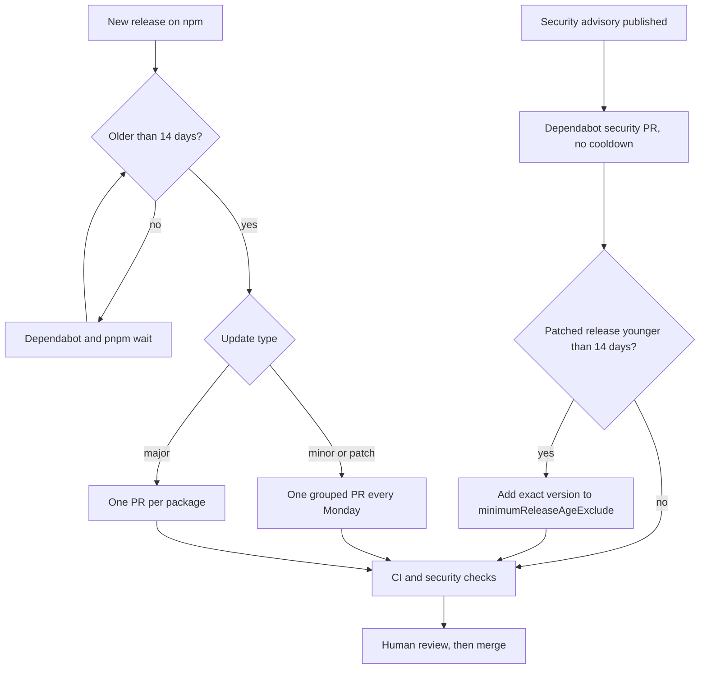

# Dependencies

Every package in this project is a person you're trusting to run code on your machine and in production, so the rules here are mostly about slowing that trust down. The project uses pnpm, pinned through `packageManager` in [`package.json`](../package.json). Running `corepack enable` once gets you the right version, and on Node.js 25 or later, which dropped corepack from the install, run `npm install -g corepack` first.

## The rules

The lockfile is committed and CI installs from it with `--frozen-lockfile`, so a change to `package.json` without a matching lockfile fails straight away.

New releases wait 14 days before pnpm will install them. `minimumReleaseAge` in [`pnpm-workspace.yaml`](../pnpm-workspace.yaml) enforces it, and the Dependabot cooldown uses the same window. The reasoning is that malicious or broken releases are usually spotted and pulled within days, so a short wait keeps most of them out at almost no cost.

Install scripts are blocked unless a package is listed under `allowBuilds`. Right now that's only `sharp`, which does image optimisation for `next/image`, and `unrs-resolver`, which the ESLint import plugin needs.

Fewer packages is better, and the `shadcn` package is the example of why. The site only ever used its stylesheet, but installing it also brought in its CLI, an MCP server, Express and an HTTP client, and those caused most of the audit advisories. The stylesheet now lives in [`src/app/shadcn.css`](../src/app/shadcn.css) and the package isn't installed. When you need a new shadcn component, run the CLI on demand:

```bash
pnpm dlx shadcn@<version> add <component>
```

## How updates arrive



Three major upgrades are held back in [`.github/dependabot.yml`](../.github/dependabot.yml), because each one needs a deliberate migration rather than a Monday-morning PR:

| Package | Held at | Reason |
| --- | --- | --- |
| `@types/node` | 24 | The types must match the Node 24 runtime on Vercel and in CI. |
| `eslint` | 9 | Upgrade when `eslint-config-next` supports the next major. |
| `typescript` | 5 | Upgrade as a separate task and test the build. |

Remove a line from `ignore` when you start that upgrade.

## Fix an advisory

1. Find the package and the patched version:

   ```bash
   pnpm audit
   ```

2. If the package is a direct dependency, upgrade it:

   ```bash
   pnpm add <package>@<patched-version>
   ```

3. If the package is transitive and its parent has no fixed release, add an override in `pnpm-workspace.yaml`. Limit the override to the vulnerable range:

   ```yaml
   overrides:
     "brace-expansion@<1.1.21": ^1.1.21
   ```

4. If pnpm refuses the patched version because it is younger than 14 days, add that exact version to `minimumReleaseAgeExclude`. Add a comment with the advisory id. Do not exclude a package name without a version.
5. Run the checks again:

   ```bash
   pnpm audit --audit-level high
   pnpm typecheck && pnpm lint && pnpm build
   ```

6. In the PR, list each package that the lockfile adds. An unexplained new package blocks the merge.

## Clean up exceptions

Both `minimumReleaseAgeExclude` and `overrides` are meant to be temporary, and they rot quietly if nobody looks at them. Check them whenever you update dependencies:

- Remove an exclude entry when its version is older than 14 days.
- Remove an override when `pnpm why <package>` shows that the parent package now brings the patched version without it.

## Update everything by hand

```bash
pnpm outdated            # what is behind
pnpm update              # newest version inside each range in package.json
pnpm audit --audit-level high
pnpm typecheck && pnpm lint && pnpm build
```

Keep `next` and `eslint-config-next` on the same minor version. After a Next.js upgrade, read the bundled docs in `node_modules/next/dist/docs/` for changed APIs.
