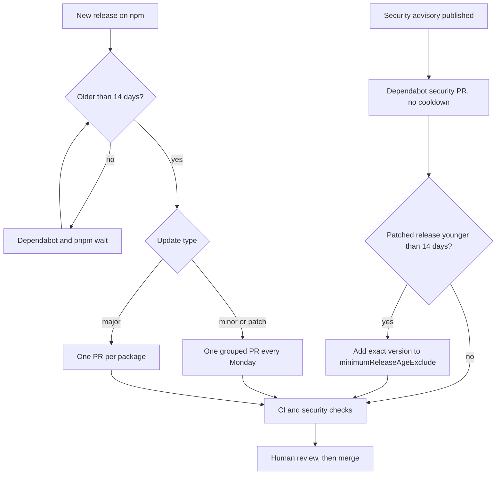

# Dependencies

This project uses pnpm. The exact version is in `packageManager` in [`package.json`](../package.json). Run `corepack enable` once, and corepack then selects that version for you.

## Rules

- **Commit the lockfile.** CI installs with `--frozen-lockfile` and fails if the lockfile does not match `package.json`.
- **Packages wait 14 days.** `minimumReleaseAge` in [`pnpm-workspace.yaml`](../pnpm-workspace.yaml) makes pnpm refuse a release that is younger than 14 days. Most malicious or broken releases are found and removed within days. The Dependabot cooldown uses the same 14 days.
- **Install scripts are blocked by default.** Only the packages under `allowBuilds` can run a postinstall script. Today that is `sharp` (image optimisation for `next/image`) and `unrs-resolver` (used by the ESLint import plugin).
- **Fewer packages is better.** Each package is a maintainer who can be compromised. For example, the site needs only the stylesheet from the `shadcn` package, so that stylesheet is copied into [`src/app/shadcn.css`](../src/app/shadcn.css). The `shadcn` package itself is not installed. It brought in its CLI, an MCP server, Express and an HTTP client, which caused most of the audit advisories. To add a shadcn component, run the CLI on demand:

  ```bash
  pnpm dlx shadcn@<version> add <component>
  ```

## How updates arrive



[`.github/dependabot.yml`](../.github/dependabot.yml) holds back three major upgrades that need a deliberate migration:

| Package | Held at | Reason |
| --- | --- | --- |
| `@types/node` | 24 | The types must match the Node 24 runtime on Vercel and in CI. |
| `eslint` | 9 | Upgrade when `eslint-config-next` supports the next major. |
| `typescript` | 5 | Upgrade as a separate task and test the build. |

Remove a line from `ignore` when you start that upgrade.

## Fix an advisory

1. Find the package and the patched version:

   ```bash
   pnpm audit
   ```

2. If the package is a direct dependency, upgrade it:

   ```bash
   pnpm add <package>@<patched-version>
   ```

3. If the package is transitive and its parent has no fixed release, add an override in `pnpm-workspace.yaml`. Limit the override to the vulnerable range:

   ```yaml
   overrides:
     "brace-expansion@<1.1.21": ^1.1.21
   ```

4. If pnpm refuses the patched version because it is younger than 14 days, add that exact version to `minimumReleaseAgeExclude`. Add a comment with the advisory id. Do not exclude a package name without a version.
5. Run the checks again:

   ```bash
   pnpm audit --audit-level high
   pnpm typecheck && pnpm lint && pnpm build
   ```

6. In the PR, list each package that the lockfile adds. An unexplained new package blocks the merge.

## Clean up exceptions

`minimumReleaseAgeExclude` and `overrides` are temporary. Check them when you update dependencies:

- Remove an exclude entry when its version is older than 14 days.
- Remove an override when `pnpm why <package>` shows that the parent package now brings the patched version without it.

## Update everything by hand

```bash
pnpm outdated            # what is behind
pnpm update              # newest version inside each range in package.json
pnpm audit --audit-level high
pnpm typecheck && pnpm lint && pnpm build
```

Keep `next` and `eslint-config-next` on the same minor version. After a Next.js upgrade, read the bundled docs in `node_modules/next/dist/docs/` for changed APIs.
